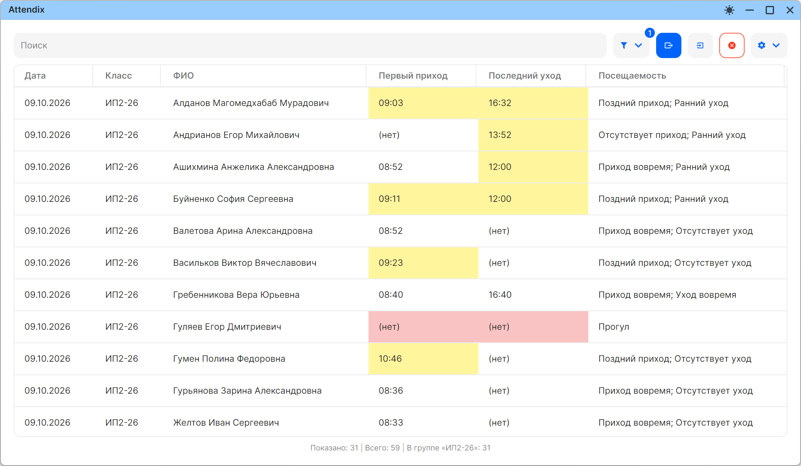
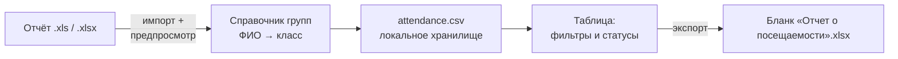

# Attendix


> Учёт посещаемости учебных групп: импорт ведомостей из внешнего отчёта,
> автоматическая привязка учеников к группам и выгрузка официального бланка
> «Отчет о посещаемости» за пару кликов.



## Что это

Локальное десктоп-приложение для преподавателя. Не требует сервера и базы
данных — все данные хранятся на компьютере пользователя, всё считается на месте.
Интерфейс полностью русифицирован.

## Возможности

- **Импорт ведомости** из `.xls` / `.xlsx` с предпросмотром: колонки даты,
  класса, ФИО, прихода и ухода сопоставляются наглядно до загрузки.
- **Справочник групп** — группа ученика подставляется автоматически по ФИО,
  какие бы классы ни были записаны в отчёте.
- **Таблица посещаемости** со статусами («Поздний приход», «Ранний уход»,
  «Прогул») и подсветкой проблемных записей.
- **Фильтры и поиск** — по имени, классу, дате; по группе; скрытие статусов.
- **Экспорт официального бланка** `.xlsx` в требуемой форме — с шапкой,
  рамками и нумерацией имён файлов `(1)`, `(2)`, …
- **Настройки**: границы занятий, светлая и тёмная темы, подсветка —
  запоминаются сами.

## Как это работает



1. Загружаете внешнюю ведомость — приложение показывает предпросмотр, где
   видно, что и как сопоставится.
2. Классы учеников исправляются по справочнику ещё на этапе импорта.
3. Дальше — обычная работа: таблица, фильтры, поиск.
4. Экспорт всегда строит бланк по актуальным данным.

## Данные

Всё хранится локально в `%APPDATA%\Attendix`: записи посещаемости, настройки и
справочник групп — с автоматическими резервными копиями после каждого сеанса
правок. При первом запуске справочник разворачивается сам.

## Запуск

Требуется [.NET 10 SDK](https://dotnet.microsoft.com/download/dotnet/10.0).

```bash
git clone <URL репозитория>
cd Attendix
dotnet run --project Attendix.Desktop
```

Для готового дистрибутива (`Attendix.x64.<версия>.exe` и переносимый `.zip`)
используется Avalonia Parcel — конфигурация уже в репозитории
(`Attendix.Desktop/Attendix.Desktop.parcel`), упаковка запускается из его GUI.

